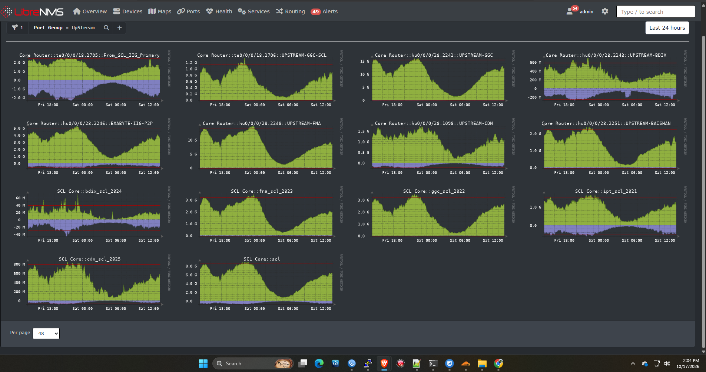

# LibreNMS Network Monitoring and Telegram Alerting

**Project Category:** Network Monitoring and Operations  
**Author:** Nahid Hossen Munna  
**Experience:** 11 Years in ISP Networking

## Project Overview

Designed and operated a network monitoring environment using LibreNMS to monitor ISP infrastructure, inspect traffic utilization, identify network faults, and deliver alerts through Telegram.

The goal was to improve operational visibility, reduce manual checking, and help identify network issues quickly.

## Technologies Used

- LibreNMS
- SNMP monitoring
- MikroTik RouterOS
- Huawei and BDCOM network devices
- Linux and Ubuntu Server
- Telegram notifications
- Traffic graphs and interface monitoring

## Key Responsibilities

### 1. Device Monitoring

- Integrated network devices with LibreNMS using SNMP.
- Monitored device availability and operational status.
- Reviewed CPU, memory, uptime, and other available device metrics.
- Investigated monitoring and SNMP communication problems.

### 2. Interface and Traffic Monitoring

- Monitored interface status and traffic utilization.
- Reviewed traffic graphs to understand network usage.
- Investigated interface errors and connectivity issues.
- Used monitoring data to support network troubleshooting.

### 3. Alerting and Notifications

- Configured alerting workflows for relevant network events.
- Used Telegram notifications to help the operations team receive alerts.
- Worked with device availability and interface-related monitoring.
- Reviewed alert conditions to reduce unnecessary notifications.

### 4. ISP Operations Support

- Used monitoring data to investigate network faults.
- Compared interface counters, device status, and traffic graphs.
- Used collected evidence to support troubleshooting and verification.

## Troubleshooting Workflow

1. Detect an alert or unusual monitoring result.
2. Identify the affected device or interface.
3. Review SNMP data, logs, traffic graphs, and interface counters.
4. Isolate the possible cause.
5. Apply an appropriate corrective action.
6. Verify recovery and monitor for recurrence.

## Project Evidence

Add sanitized screenshots in this section when available:

- LibreNMS device overview
- Interface traffic graph
- Alert rule configuration with sensitive information hidden
- Example Telegram alert
- Device health or performance dashboard

## Security

All screenshots and configuration examples published in this portfolio must exclude passwords, SNMP communities, API keys, Telegram bot tokens, customer details, and confidential production information.

## Outcome

This monitoring workflow supports centralized visibility, faster fault investigation, and more consistent monitoring of ISP network infrastructure.

*This project description summarizes my practical monitoring and operations experience. Specific results depend on the monitored environment and configuration.*
## Monitoring Dashboard Screenshot

The dashboard provides visibility into network monitoring, device status, and traffic information.

## LibreNMS Dashboard Overview

This dashboard provides centralized visibility into network availability, health sensors, core router CPU, syslog, event logs, and alerts.

