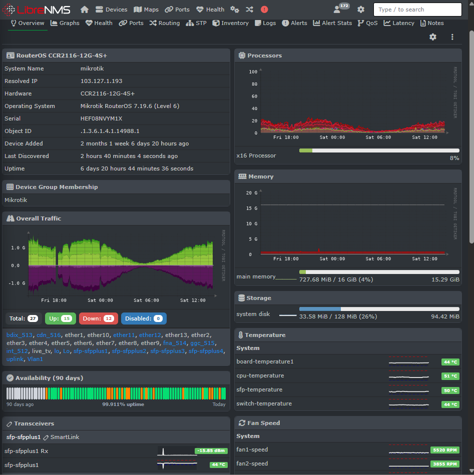
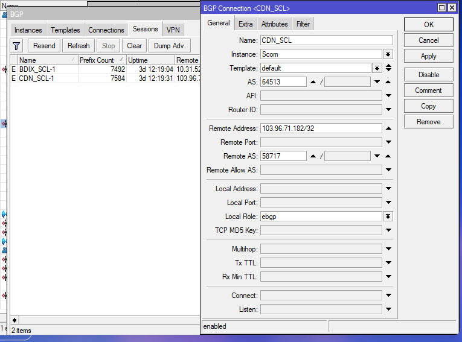

# MikroTik BGP and ISP Routing

**Project Category:** ISP Routing and Traffic Engineering  
**Author:** Nahid Hossen Munna  
**Experience:** 11 Years in ISP Networking

## Project Overview

Practical experience in operating and troubleshooting ISP routing infrastructure using MikroTik RouterOS. My work includes BGP peer monitoring, routing policy, VLAN-based traffic separation, NAT, and upstream connectivity troubleshooting.

## Technologies

- MikroTik RouterOS v6 and v7
- Border Gateway Protocol (BGP)
- IPv4 routing and route selection
- VLAN-based traffic separation
- Network Address Translation (NAT)
- Upstream connectivity monitoring
- Interface and traffic analysis

## Key Responsibilities

### 1. BGP Routing

- Monitored BGP peer status and connectivity.
- Investigated routing issues affecting upstream and external reachability.
- Reviewed learned and advertised routes where applicable.
- Checked route selection and routing policy behavior.
- Verified connectivity after routing changes.

### 2. Upstream Connectivity

- Worked with multiple upstream and content-network connections.
- Monitored interface utilization and link status.
- Investigated packet loss, route instability, and reachability problems.
- Compared traffic and routing information to help isolate faults.

### 3. VLAN and Traffic Separation

- Used VLANs to separate network traffic by service or upstream path.
- Checked VLAN interfaces and connectivity between network devices.
- Reviewed traffic counters to identify unexpected utilization or forwarding issues.

### 4. NAT and Traffic Troubleshooting

- Worked with NAT configuration and connectivity troubleshooting.
- Investigated traffic-path problems and packet loss.
- Verified connectivity after configuration changes.
- Considered CPU load, interface errors, routing, and upstream behavior during diagnosis.

## Troubleshooting Workflow

1. Check the affected BGP peer and interface status.
2. Verify IP reachability between peers.
3. Inspect routes and routing policies.
4. Check VLANs, NAT, and the intended traffic path.
5. Review interface counters and traffic utilization.
6. Apply a controlled change and verify reachability.
7. Monitor the network for recurrence.

## Project Evidence

Add sanitized evidence when available:

- BGP peer status screenshot
- Routing table with sensitive information removed
- Network topology diagram
- VLAN traffic overview
- Example troubleshooting notes

## Security

Do not publish live router configurations containing passwords, BGP authentication keys, SNMP communities, public management addresses, customer IP addresses, or other sensitive production details.

Use sanitized examples and documentation rather than unredacted production configurations.

## Outcome

This experience supports ISP routing operations, BGP troubleshooting, upstream connectivity analysis, and traffic-path verification.

*This project documents practical experience. Specific routing designs and results depend on the network architecture and operational requirements.*
## MikroTik Monitoring with LibreNMS

Monitor MikroTik router availability, uptime, CPU, memory, interface traffic, and device health through LibreNMS.

## BGP Peer Status Monitoring

Monitor BGP peer/session status through LibreNMS to support ISP routing visibility and troubleshooting.

